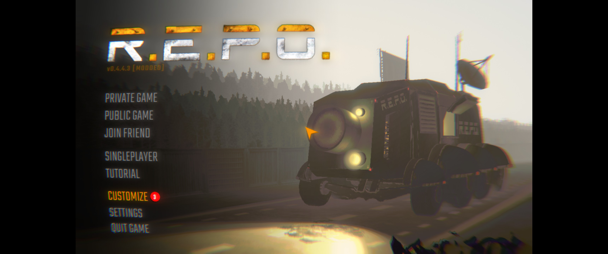
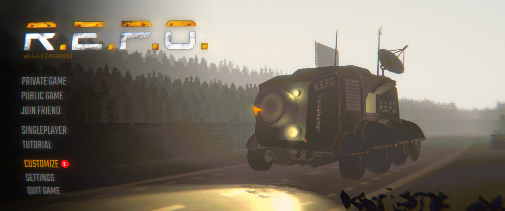
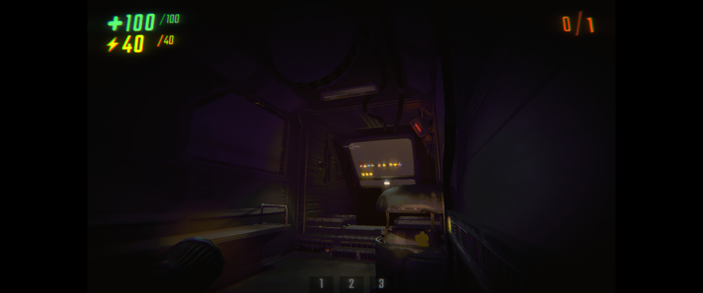
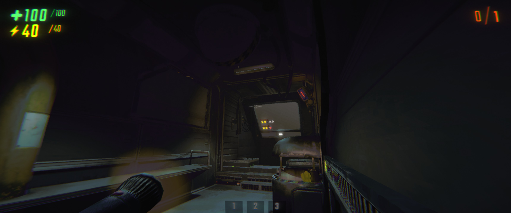
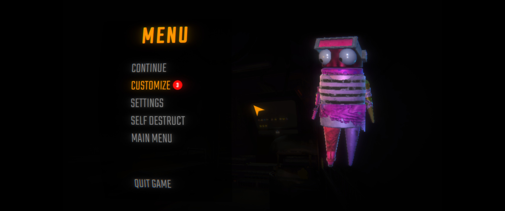
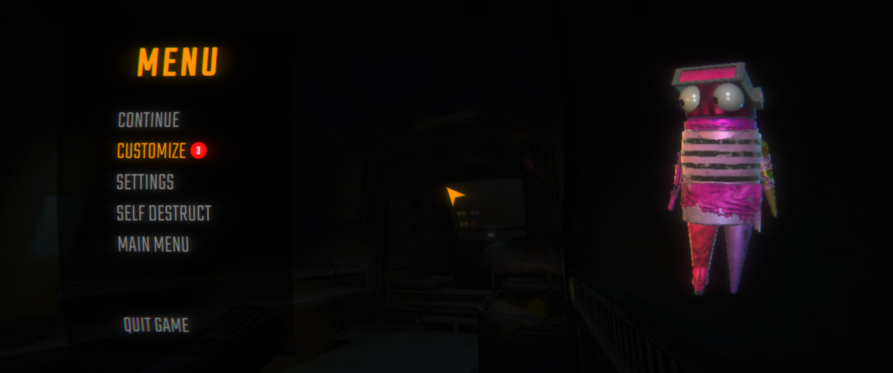

# REPONativeUltrawide

**Probably the best ultrawide mod for R.E.P.O.**

Other ultrawide mods get the game world right - FovUpdate, for example, expands the camera correctly - but they just **stretch** the interface to fill your screen, so the UI ends up distorted. This mod fixes the part they skip.

It **adapts** the interface to your ultrawide monitor: HUD elements, menus and prompts are rebuilt so they sit at the *real* screen edges - not squished, not stretched, the way it would look if the game shipped with native ultrawide support. It handles the game's rendering on its own too, so it works standalone.

## Features

- No stretching - the game and the UI are adapted, not distorted
- HUD elements moved out to the true screen edges (same margins as 16:9)
- Menus, pause, lobby and settings spread across the full width; popups stay centered
- Loading screens, startup splashes and tutorial bars fixed too
- The mouse cursor reaches the whole screen
- Item discovery highlights line up with the items across the whole width
- The "old TV" lens distortion and chromatic aberration are toned down so the edges stay readable (or turned off on the HUD entirely, if you prefer)
- Works with **any** aspect ratio wider than 16:9 - 21:9, 32:9, whatever you've got
- **Fully standalone** - no other mods required

## Compatibility

Updated for R.E.P.O. v0.5.0. Runs on its own. Compatible with **FovUpdate**, **BetterView** and, as far as I can tell, any other mod.

Client-side only - just you need it installed.

## Screenshots

|            | Without the mod | With the mod |
| ---------- | --------------- | ------------ |
| **Main menu** |  |  |
| **In-game**   |  |  |
| **Pause**     |  |  |

## Configuration

A few toggles in `BepInEx/config/com.github.NEDOSTUPN0.REPONativeUltrawide.cfg`:

- **Enabled** - master switch
- **Lens Distortion Fix** - tone down the edge distortion and chromatic aberration on ultrawide
- **Disable HUD Lens Effects** - turn the distortion and chromatic aberration off on the HUD completely (off by default; for the world use the game's own Lens Effect / Chromatic Aberration settings)
- A debug UI-dump key (unbound by default)

## Notes

On screens 16:9 or narrower the mod does nothing - it only kicks in when your display is wider than 16:9. Ultratall (taller than 16:9) is not supported.

---

*Fully vibe-coded with Claude Code - but it seems to work great anyway.*
